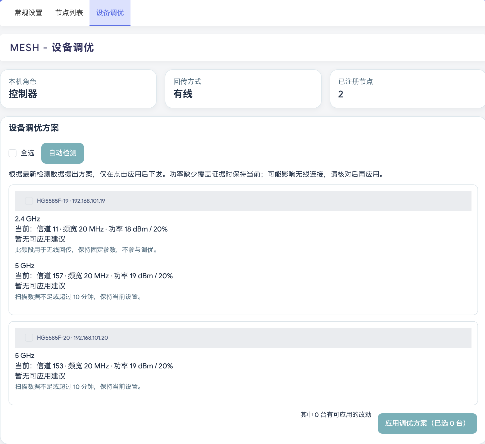

# QMESH for OpenWrt

QMESH 是一个帮助你统一管理多台无线 AP 的路由器插件。你可以在一台路由器上设置 Wi-Fi 名称和密码，再把设置同步到其他 AP，不用逐台登录修改。

负责管理的路由器叫作「控制器」，提供 Wi-Fi 的设备叫作「AP」。控制器本身可以没有无线功能。两种角色使用同一个安装包，安装后在「网络 → QMESH」中选择。

AP 上的后台程序叫作 Agent，它会主动连接控制器，大约每 20 秒报告一次状态。

## 能做什么

- **统一设置 Wi-Fi**：一起修改多台 AP 的 Wi-Fi 名称、密码和漫游设置。
- **批量添加 AP**：生成一个接入码，多台 AP 都能用它加入。接入码默认 30 分钟有效。
- **查看设备状态**：看到 AP 是否在线、是否已同步、连接了多少客户端。
- **调整无线参数**：查看和修改各频段的信道、频宽、发射功率，改好后一次应用。
- **提供调优建议**：检测周围无线网络，给出调整建议，由你决定是否应用，不会自动修改。
- **单独删除 AP**：取消某台 AP 的接入资格，不影响其他 AP。
- **适配手机和暗色界面**：在手机上也能查看和设置。
- **保留升级资料**：0.1.63 增加固件升级保留清单，用来保留角色、接入资料和已有的双回传证书。

部分经过配对和测试的设备还支持「双回传」：平时走网线，网线断开时改走无线，网线恢复后再切回来。这个功能有设备限制，详见下文。

## 界面预览

以下为功能截图，部分截图中的旧标题仍显示 MESH，当前版本使用 QMESH。

### 常规设置


### 节点列表


### 设备调优



### AP 设置


## 安装前先做好这些准备

1. **确认控制器和 AP 能互相访问。** 控制器的管理页面需要支持 HTTPS，也就是能用 `https://` 开头的地址打开。
2. **确认 AP 的 Wi-Fi 已启用。** 无线驱动也要支持你准备使用的功能。
3. **先把 AP 的网络设置好。** 常见的有线 AP 接法是：设置一个不冲突的固定管理 IP，关闭 AP 自己的 DHCP 地址分配功能，让主路由统一分配地址，并把 Wi-Fi 接到 LAN 网络。已有 VLAN 等特殊设置时，按自己的网络规划配置。
4. **尽量用网线管理设备。** 安装或修改 Wi-Fi 时可能短暂断网，网线方便你继续操作。
5. **先备份。** 插件不会替你设置 LAN、DHCP、VLAN 或桥接关系，切换角色也不会自动完成这些设置。

熟悉 SSH 的用户，可以在路由器上运行下面的命令备份相关配置。完成后会显示备份目录，请再把它下载到电脑保存。

```sh
umask 077
mesh_backup_dir=$(mktemp -d /root/qmesh-backup.XXXXXX)
for mesh_path in /etc/mesh-control /etc/config/qmesh \
    /etc/config/mesh-control-agent /etc/config/mesh-backhaul \
    /etc/config/network /etc/config/wireless /etc/config/firewall \
    /etc/sysupgrade.conf; do
    if [ -e "$mesh_path" ]; then
        mkdir -p "$mesh_backup_dir$(dirname "$mesh_path")"
        cp -pR "$mesh_path" "$mesh_backup_dir$mesh_path"
    fi
done
printf '备份目录：%s\n' "$mesh_backup_dir"
```

备份里可能有 Wi-Fi 密码、接入令牌和证书私钥，不要发到群里或公开上传。

## 下载哪个安装包

到 [0.1.63 下载页面](https://github.com/Opnwall/QMESH/releases/tag/v0.1.63) 选择：

| 文件 | 什么时候用 |
| --- | --- |
| `luci-app-mesh-control_0.1.63-1_all.ipk` | 路由器用 `opkg` 安装软件时选它 |
| `luci-app-mesh-control-0.1.63-r1.apk` | 路由器用 `apk` 安装软件时选它；这不是安卓应用 |
| `QMESH-0.1.63-source-IPK-APK.zip` | 想下载源码、构建脚本和两种安装包时选它 |
| `SHA256SUMS` | 用来检查下载文件是否完整 |

控制器和 AP 都用同一个包，不用分别安装。设备刷过机后，要以新固件使用的安装方式为准。

安装包里仍用旧名称 `luci-app-mesh-control`，方便旧版本升级；安装后的菜单显示为 QMESH。文件名中的 `all` 或 `noarch` 不代表所有设备的无线功能都能使用，仍要看固件、驱动和所需的软件是否支持。

### 检查下载文件（可选）

把下载文件和 `SHA256SUMS` 放在同一目录。如果下载了清单里的全部文件，可以在电脑上运行下面的命令检查：

```sh
# macOS
shasum -a 256 -c SHA256SUMS
# Linux / OpenWrt
sha256sum -c SHA256SUMS
```

只下载部分文件时，核对相应文件的校验值即可；没有下载的文件会提示找不到。

## 安装和升级

下面的命令在路由器的 SSH 终端里执行。先把选好的安装包上传到路由器的 `/tmp/` 目录，再按对应方式安装。

### IPK

```sh
opkg install /tmp/luci-app-mesh-control_0.1.63-1_all.ipk
```

第一次安装和从旧的一体化版本升级，都用这条命令。升级会沿用现有配置和角色，但操作前仍建议备份。

如果要重装同一个版本：

```sh
opkg --force-reinstall install /tmp/luci-app-mesh-control_0.1.63-1_all.ipk
```

### APK

```sh
apk add --allow-untrusted /tmp/luci-app-mesh-control-0.1.63-r1.apk
```

这个 APK 没有签名，所以安装时需要加 `--allow-untrusted`。如果所需的软件都已装好，可以加 `--no-network`；重装同一个版本时，可以加 `--force-reinstall`。

如果提示缺少依赖软件，先解决缺少的软件，不要强行跳过检查。内核模块也必须与当前固件匹配。

如果你以前装的是分开的 `mesh-control-controller` 和 `mesh-control-agent`，请先备份，再移除旧分包、安装现在的一体化包，以免文件冲突。正在使用双回传时，先确认网线已连接。

## 怎么开始使用

### 第一步：设置控制器

1. 打开「网络 → QMESH → 常规设置」。
2. 选择「控制器」，点击「应用角色」。
3. 在「无线配置」中填写 Wi-Fi 名称（SSID）和密码，按需打开漫游，再点击「同步配置」。密码支持 8–63 个英文字符、数字或常用符号，不支持中文。已经保存过密码时，留空提交会继续使用原密码。
4. 在「节点注册」中点击「生成接入码」。系统会自动带上控制器地址和用于核对身份的证书信息，不用你手填。
5. 点击「复制接入码」，准备把它粘贴到 AP 上。

### 第二步：让 AP 加入

1. 给 AP 安装相同版本的 QMESH。
2. 打开常规设置，选择「AP」。
3. 粘贴完整接入码，勾选要让控制器管理的无线接口。
4. 点击「应用角色」，等待显示绿色「已同步」。
5. 回到控制器的「节点列表」，确认这台 AP 是「在线、已同步」，再用手机连接 Wi-Fi，检查能否正常上网。

### 接入码要注意什么

- 同一个接入码可以给多台 AP 用，每台 AP 会自动获得自己的身份资料。
- 默认 30 分钟后过期。已加入的 AP 不会因此掉线，仍能继续同步。
- 刷新控制器页面后，还能看到未过期的接入码并继续复制。
- 生成新码会让旧码失效，已加入的 AP 不受影响。
- 已经接入的 AP，接入码留空就会沿用原资料。
- 不要公开接入码，也不要把一台 AP 的 `/etc/config/mesh-control-agent` 复制给另一台，以免两台设备共用同一个身份。

AP 页面也保留三个菜单，但管理节点和设备调优要到上级控制器操作。

## 怎么看状态、调整 Wi-Fi

| 页面上的信息 | 是什么意思 |
| --- | --- |
| 绿色「在线」 | 最近 60 秒内，AP 向控制器报告过状态 |
| 红色「离线」 | 超过 60 秒没有收到 AP 的报告，需要检查连接 |
| 「已同步」 | AP 已确认应用了控制器的配置；还要实际连接 Wi-Fi 检查上网和漫游 |
| 「客户端」 | 当前连接到受管无线接口的设备数量；「—」表示没有读到数量 |
| 「删除」 | 取消这台 AP 的接入资格，其他 AP 不受影响；不会清空它最后使用的 Wi-Fi 设置 |

想手动修改时，展开「调整参数」，选择信道、频宽或功率。可以先改好多台 AP，最后点击一次「应用更改」。

想参考建议时，进入「设备调优」，先勾选设备，再点击「自动检测」。系统只给出建议，只有你点击应用后才会修改。

检测周围的 Wi-Fi 不等于测出了每个房间的覆盖效果。没有足够的信号覆盖数据时，系统会保持当前功率；建议也不保证是最优结果。用于无线回传的频段不会单独调整，避免备用链路断开。

修改无线参数可能短暂断网。漫游是否顺畅，还取决于手机、电脑和 AP 驱动，不保证完全无感切换。

## 双回传是什么，能直接用吗

双回传就是给 AP 准备两条上网路径：**平时用网线，网线断开时用无线连接另一台 AP，网线恢复后再切回去。**

目前只在两台配对的 HG5585F 测试设备上验证过，使用专用 2.4 GHz 无线链路，加上带证书验证的 OpenVPN TAP 隧道。这不是通用的原生 802.11s 或 EasyMesh 功能。

安装 QMESH 不会自动配对，也不会自动生成证书或安装 OpenVPN。其他设备需要另外检查和适配，不能直接照抄测试设备的端口配置。两台中至少一台要保持有线上联，否则无法靠这条备用链路访问上级网络。

冷启动、IPv6、长期高负载和大量设备一起运行的情况，还没有完成验证。

## 刷固件时，怎样保留配置

0.1.63 增加了角色保存和升级保留清单，用来避免刷机后 AP 变成控制器、双回传证书丢失的问题。

相关资料保存在：

| 路径 | 保存什么 |
| --- | --- |
| `/etc/config/qmesh` | 本机是控制器还是 AP |
| `/etc/config/mesh-control-agent` | AP 连接控制器所需的资料 |
| `/etc/config/mesh-backhaul` | 已配置的双回传设置 |
| `/etc/mesh-control/` | 旧角色文件、控制器资料、节点资料和已有双回传证书、私钥 |

刷固件前，先安装本版本，用 `sysupgrade -l` 检查保留清单，再生成备份并下载到电脑：

```sh
umask 077
sysupgrade -b /root/qmesh-before-firmware.tar.gz
tar -tzf /root/qmesh-before-firmware.tar.gz | grep -E 'etc/config/(qmesh|mesh-control-agent|mesh-backhaul)|etc/mesh-control/'
```

**勾选「保留配置」，不等于插件本身也会保留。** 如果新固件没有内置 QMESH、OpenVPN 或所需的软件，刷机后仍要重新安装，再检查角色、AP 同步和双回传状态。

刷机前请按本节步骤核对备份内容。目前检查过实际生成的备份包包含这些资料，但还没有通过重新刷机来验证整个恢复过程。备份含敏感资料，请不要公开。

## 遇到问题先看这里

| 问题 | 可以先检查什么 |
| --- | --- |
| AP 离线 | AP 能不能访问控制器、HTTPS 是否正常、Agent 有没有运行、系统时间是否正确 |
| 接入码无效 | 是否完整复制、是否过期、控制器和 AP 的版本是否兼容 |
| 在线但未同步 | 页面有没有报错、无线接口是否启用、驱动是否支持、是否还有未保存的无线修改 |
| 刷机后变成控制器 | 角色和 AP 接入资料有没有保留下来，可用 `uci -q get qmesh.main.role` 查看角色 |
| 双回传不工作 | OpenVPN、所需内核模块、证书是否齐全，网线端口和备用无线链路是否正确 |
| 页面还是旧样式或旧标题 | 强制刷新浏览器，并确认安装版本 |

通过 SSH 检查 AP 后台程序：

```sh
/etc/init.d/mesh-control-agent enabled
/etc/init.d/mesh-control-agent running
```

需要卸载时，按设备的安装方式选择一条命令：

```sh
opkg remove luci-app-mesh-control
# 或
apk del luci-app-mesh-control
```

## 想修改源码或自己打包

普通安装用户可以跳过这一节。

```text
controller/   控制器和网页界面
agent/        AP 后台程序及双回传脚本
scripts/      打包脚本
tests/        功能检查脚本
build.py      生成安装包
BUILD.md      详细构建方法
```

在源码目录运行：

```sh
sh scripts/build-release.sh
```

需要 Python 3。脚本会生成 IPK 和用于制作 APK 的文件。要生成 APK，还需要在 Linux 环境准备支持 `mkpkg` 的 APK v3 工具；缺少工具时会提示 APK 尚未生成。详细步骤见 [构建说明](BUILD.md)。

反馈问题时，请附上设备型号、固件版本、插件版本和报错信息。如果知道驱动类型，也请一起说明。发日志前先去掉密码、令牌、接入码和私钥。
