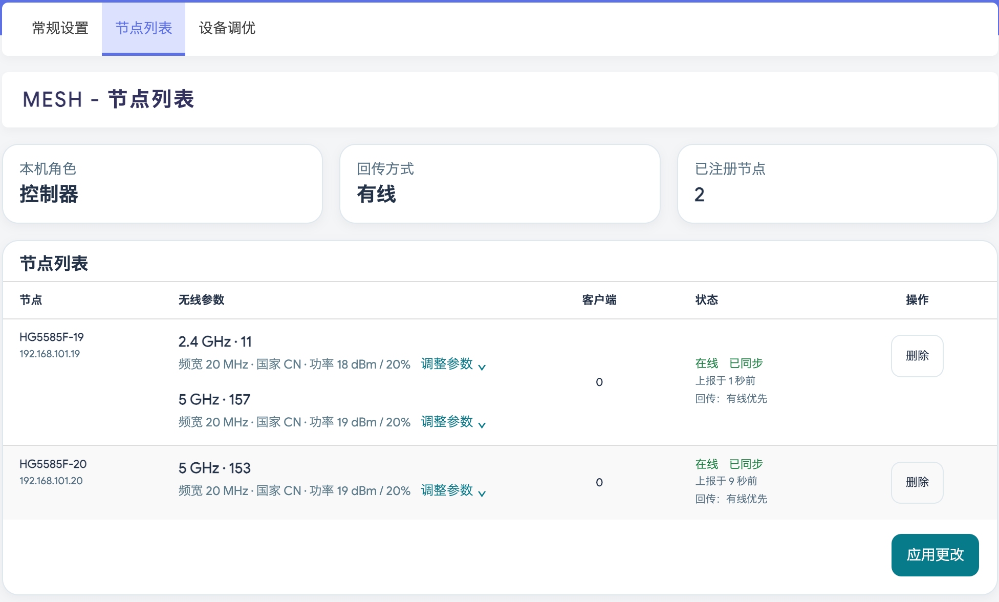

# QMESH for OpenWRT

面向 OpenWrt 的 LuCI 无线集中管理插件。没有 Wi-Fi 的路由器也可以作为控制器，统一管理多台无线 AP。

**当前版本：0.1.63** · [下载安装包](https://github.com/Opnwall/QMESH/releases/latest) · [构建说明](BUILD.md) 

QMESH 提供控制器与 Agent 的一体化 IPK、APK。控制器负责配置和状态管理，AP 通过 HTTPS 主动连接控制器，约每 20 秒上报一次。它不替代本机的网络、DHCP、VLAN 或桥接配置，也不代表所有设备都支持原生 802.11s / EasyMesh。

## 主要功能

- 同一个安装包切换控制器、AP 角色，菜单位于「网络 → QMESH」。
- 统一下发 SSID、WPA2-Personal 密码及 802.11r/k/v 漫游配置；密码支持眼睛图标显示。
- 30 分钟有效的批量接入码，多台 AP 共用接入码，每台分配独立节点 ID 和令牌，可单独删除。
- 接入码刷新后仍可复制；接入码到期不影响已接入节点继续同步。
- 节点列表展示主机名、地址、客户端数、在线/同步状态，以及各频段的信道、频宽、国家、功率。
- 展开「调整参数」手动选择信道、频宽和功率，最后一次「应用更改」提交。
- 设备调优支持勾选节点、主动检测、生成建议和手动应用；不会后台自动调整。
- 概览节点状态、手机卡片布局和系统暗色适配。
- 已配对测试设备支持有线优先、断线切无线、恢复后切回有线的双回传。
- 增加角色持久化和固件升级备份清单，保留已有接入资料及双回传证书。

## 界面预览

以下为功能截图。

### 常规设置


### 节点列表



### 设备调优


### AP 设置


## 安装前准备

1. 控制器需提供 HTTPS；AP 必须能通过管理网络访问控制器。
2. AP 需有已启用、驱动支持的无线 AP 接口。
3. AP 手动分配IP，禁用 DHCP 功能，并将无线桥接到 LAN。
4. 安装时保留一条可靠的有线管理路径，固件软件源需能满足依赖。

```sh
umask 077
mesh_backup_dir=$(mktemp -d /root/qmesh-backup.XXXXXX)
for mesh_path in /etc/mesh-control /etc/config/qmesh \
    /etc/config/mesh-control-agent /etc/config/mesh-backhaul \
    /etc/config/network /etc/config/wireless /etc/config/firewall \
    /etc/sysupgrade.conf; do
    if [ -e "$mesh_path" ]; then
        mkdir -p "$mesh_backup_dir$(dirname "$mesh_path")"
        cp -pR "$mesh_path" "$mesh_backup_dir$mesh_path"
    fi
done
printf '备份目录：%s\n' "$mesh_backup_dir"
```

## 下载安装包

到 [v0.1.63 Release](https://github.com/Opnwall/QMESH/releases/tag/v0.1.63) 下载：

| 文件 | 用途 |
| --- | --- |
| `luci-app-mesh-control_0.1.63-1_all.ipk` | 使用 opkg 的 OpenWrt / QWRT / iStoreOS |
| `luci-app-mesh-control-0.1.63-r1.apk` | 使用 APK v3 的 OpenWrt；不是 Android 应用 |
| `QMESH-0.1.63-source-IPK-APK.zip` | 源码、构建脚本、IPK、APK、README 和升级说明 |
| `SHA256SUMS` | 发布附件的完整性校验 |

按实际包管理器选择一种格式，控制器和 AP 使用同一安装包。`all` / `noarch` 表示本包主要包含脚本与 LuCI 文件，依赖及无线能力仍须与设备固件匹配。

安装包名称保留为 `luci-app-mesh-control`，便于从旧版本升级；菜单名为 QMESH。

把下载文件和 `SHA256SUMS` 放在同一目录，核对相应文件的 SHA256。下载全部附件时可执行：

```sh
# macOS
shasum -a 256 -c SHA256SUMS
# Linux / OpenWrt
sha256sum -c SHA256SUMS
```

### IPK 安装和升级

将 IPK 上传至路由器 `/tmp/` 后执行：

```sh
opkg install /tmp/luci-app-mesh-control_0.1.63-1_all.ipk
```

从旧一体化版本升级使用相同命令，保留当前配置和角色。同版本重装可用：

```sh
opkg --force-reinstall install /tmp/luci-app-mesh-control_0.1.63-1_all.ipk
```

### APK 安装和升级

将 APK 上传至路由器 `/tmp/` 后执行：

```sh
apk add --allow-untrusted /tmp/luci-app-mesh-control-0.1.63-r1.apk
```

APK 是本地构建的未签名包，需要 `--allow-untrusted`。依赖齐全时可增加 `--no-network`；同版本重装可增加 `--force-reinstall`。不要强制忽略依赖，不要跨内核安装不匹配的 kmod。

从旧的 `mesh-control-controller`、`mesh-control-agent` 分包迁移，须先完成备份，再移除旧分包并安装一体化包，避免文件冲突；启用双回传的设备先恢复有线上联。

## 配置控制器与 AP

### 控制器

1. 打开「网络 → QMESH → 常规设置」，选择「控制器」，点击「应用角色」。
2. 在「无线配置」填写 SSID、密码及漫游开关，点击「同步配置」。WPA2 密码为 8–63 个可打印 ASCII 字符；升级后的空密码提交沿用保存密码。
3. 在「节点注册」点击「生成接入码」，系统自动取得 LAN 地址和证书公钥指纹，生成默认 30 分钟有效的批量接入码。
4. 复制接入码，分发给需要接入的 AP；不要公开接入码。

### AP

1. 安装相同版本，在常规设置选择「AP」。
2. 粘贴完整接入码，勾选要管理的无线 AP 接口。
3. 点击「应用角色」，等待显示绿色「已同步」。
4. 在上级控制器「节点列表」确认节点在线、已同步，并实测无线连接和上网。

已接入的 AP 可留空接入码沿用已保存资料。不要复制另一台 AP 的 `/etc/config/mesh-control-agent`，否则会共用节点身份。生成新批量码会使旧批量码失效；已经接入的 AP 不受码到期影响。

AP 模式保留三个菜单，节点管理及调优页面提示前往上级控制器。切换角色不会自动改变 LAN、DHCP 或 AP 桥接模式。

## 状态和设备调优

- 60 秒内有上报显示绿色「在线」，超时显示红色「离线」。
- 「已同步」表示 Agent 确认配置版本，不等于已经完成无线广播、吞吐量或漫游测试。
- 客户端数为受管接口关联 MAC 去重后的数量，未取得时显示「—」。
- 「删除」撤销单个节点凭据，不会清空 AP 最后应用的无线配置。
- 「调整参数」默认收起；每个频段可修改信道、频宽、功率，再统一应用。
- 「设备调优」先选设备再检测，按最新扫描生成建议；只有点击应用才下发。
- 回传占用的频段保持固定参数，不参与独立调优。

调优基于邻居扫描，不能代替房间覆盖勘测。缺少覆盖证据时功率保持当前；信道占用率和邻居频宽缺失时，不能据此宣称最优。应用无线参数可能短暂断网；漫游效果取决于驱动和客户端，不保证无感切换。

## 双回传支持范围

当前仅在两台配对的 HG5585F 测试设备上验证，采用专用 2.4 GHz AP Client 链路和双向证书认证的 OpenVPN TAP 隧道，不是原生 802.11s。

至少一台 AP 必须有线上联。单独安装 QMESH 不会自动配对、签发证书或安装 OpenVPN。其他驱动、硬件和网络拓扑需要另外适配；不要直接复制测试端口配置。冷启动、IPv6、长期压力及大规模部署尚未完成验证。

## 固件升级：保留角色和双回传资料

角色持久化到 `/etc/config/qmesh`，兼容 `/etc/mesh-control/role`，并添加固件升级保留路径：

- `/etc/config/qmesh`
- `/etc/config/mesh-control-agent`
- `/etc/config/mesh-backhaul`
- `/etc/mesh-control/`，包含已有控制器资料、节点凭据及双回传证书/私钥。

升级前先安装本版本，再检查 `sysupgrade -l`，并生成备份下载到电脑：

```sh
umask 077
sysupgrade -b /root/qmesh-before-firmware.tar.gz
tar -tzf /root/qmesh-before-firmware.tar.gz | grep -E 'etc/config/(qmesh|mesh-control-agent|mesh-backhaul)|etc/mesh-control/'
```

**保留配置不等于保留软件。** 新固件未内置 QMESH、OpenVPN 或依赖时，刷机后仍需重装匹配的软件包。

## 常见问题

| 问题 | 排查方向 |
| --- | --- |
| 节点离线 | 管理网络、控制器 HTTPS、Agent 服务及系统时间 |
| 接入码无效 | 完整复制、确认未过期、控制器/AP 版本兼容 |
| 在线但未同步 | 查看错误提示、驱动能力、接口是否启用、是否有未提交的无线更改 |
| 刷机后变成控制器 | 检查角色文件、`uci -q get qmesh.main.role`、接入配置及升级备份 |
| 双回传不工作 | 检查 OpenVPN、匹配的 tun 模块、证书、实际有线端口及无线备用链路 |
| 页面仍显示旧标题 | 强制刷新浏览器，确认安装版本和 LuCI 缓存 |

AP 服务检查：

```sh
/etc/init.d/mesh-control-agent enabled
/etc/init.d/mesh-control-agent running
```

卸载：

```sh
opkg remove luci-app-mesh-control
# 或
apk del luci-app-mesh-control
```

## 源码与构建

```text
controller/   LuCI、RPC、HTTPS 接口、样式、固件升级保留清单
agent/        AP Agent、双回传服务及脚本
scripts/      发布构建入口
 tests/       调优、无线参数批量处理及扫描检查
build.py      一体化包生成器
BUILD.md      IPK / APK 构建要求及命令
UPGRADE.md    固件升级备份与恢复说明
```

```sh
sh scripts/build-release.sh
```

需要 Python 3；生成 IPK 和 APK 构建输入。构建 APK 还需要 Linux 上支持 `mkpkg` 的 APK v3 工具；缺少工具时脚本会明确提示 APK 未构建。详情见 [BUILD.md](BUILD.md)。

提交问题时请提供固件版本、设备型号、驱动类型、插件版本及脱敏日志。
